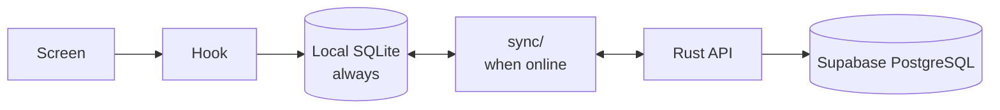

# Frontend architecture (`app/`)

**Status:** agreed in discussion, 2026-11-24
**Focus now:** the **web** version. The same code becomes the Android app later.
All users (teachers and HOD) can use either the web or the phone app.

## 1. Technology
| Need | Choice | Why |
|---|---|---|
| Framework | Expo + React Native + TypeScript | One codebase for web and Android |
| Navigation | Expo Router | One file = one screen; real web links (`/enseignant/progression`) |
| Local storage (offline) | SQLite via `expo-sqlite`, queries with Drizzle | Screens work without internet |
| Login | Supabase client (sign-in only) | See decision 0002 |
| Shared state | React context | Small app, no extra library needed |
| Form checks | Zod | Clear rules, e.g. "≥ 10" cannot exceed "évalués" |
| Charts and UI | Reused from `prototype/` (react-native-svg) | Same look the owner already approved |
| Tests | Jest + React Native Testing Library | Logic and key screens |

## 2. How data flows

- Screens **never** call the server directly. They read and write local storage through hooks.
- `sync/` sends local changes and pulls updates in the background.
- Login is the only direct call to Supabase.

## 3. Screens (first version)
| Route | Who | Purpose |
|---|---|---|
| `/` | everyone | Welcome page |
| `/connexion` | everyone | Sign in |
| `/enseignant` | teacher | Dashboard (light) |
| `/enseignant/progression` | teacher | Tick lessons done against the fiches |
| `/enseignant/sequences` | teacher | Enter class counts per séquence |
| `/hod` | HOD | Department dashboard (light) |
| `/hod/analyses` | HOD | "Analyses et statistiques" |
| `/hod/rapport` | HOD | Rapport du CE, "Rédigé par le système" |
| `/hod/gestion` | HOD | Teachers, classes, school year |

A teacher who opens a `/hod` page is sent back to `/enseignant`. The server also refuses: hiding a page is never the only protection.

## 4. Web-specific points
- The web version is a static site (HTML + JS) built with `npx expo export --platform web`. No server is needed for the website itself.
- Offline on the web: `expo-sqlite` on web is newer than on phones and needs two special HTTP headers (COOP/COEP) from the web host. **To verify first** on our Expo version. Fallback if it is not reliable: keep the web online-only at first, and do offline on Android.
- Login session on the web is kept in browser storage; on the phone, in secure storage.
- Layout: designed at 360 px wide first, then widened for laptops (sidebar on large screens, top bar on phones).

## 5. Folder map
See `app/README.md` and the README inside each `app/src/` folder.

## 6. Open points
- Confirm web offline (section 4) before Phase 1 ends.
- Oldest Android phone teachers use (affects performance targets later).
