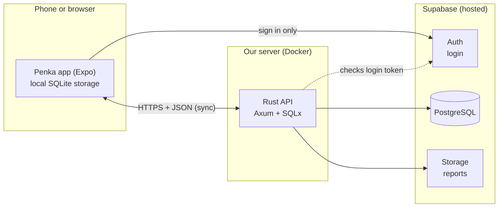

# Architecture overview

- The app saves everything locally first (SQLite), so it works offline.
- When online, the app syncs its changes with the server.
- The server is the shared source of truth for the whole department.
- The app signs in with Supabase Auth, then sends its token to the Rust API.
- The Rust API checks the token, reads the user's role and does all the school logic.
- PostgreSQL and file storage are hosted by Supabase.

See `decisions/0001-stack.md` and `decisions/0002-supabase.md`.
